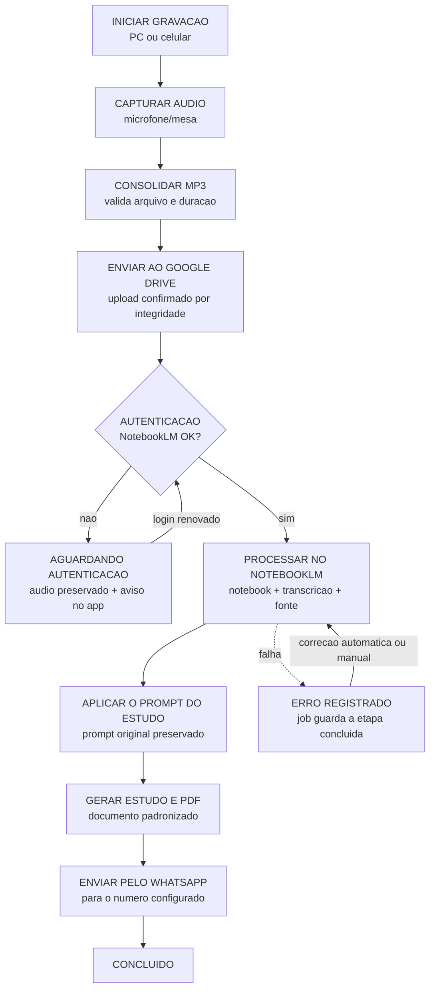
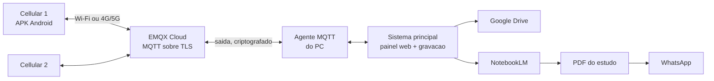

# Pregacao Recorder

**Da mesa de som ao WhatsApp: gravacao automatica de pregacoes com estudo
biblico pronto para distribuicao.**

O Pregacao Recorder e o sistema que grava os cultos no PC da igreja e leva o
processamento ate o final sem intervencao de ninguem:

```
GRAVAR  ->  MP3  ->  GOOGLE DRIVE  ->  NOTEBOOKLM  ->  PROMPT  ->  ESTUDO  ->  PDF  ->  WHATSAPP
```

O operador acompanha tudo pelo celular (APK) ou pelo navegador, de qualquer
lugar, enquanto o PC trabalha em segundo plano, em silencio e sem abrir
janelas de terminal.

---

## O problema que o sistema resolve

Gravar, nomear, enviar, transcrever, estudar, montar documento e distribuir
manualmente consome horas por semana e erra por detalhe (audio perdido,
arquivo com nome errado, estudo que ninguem distribuiu). O Pregacao Recorder
assume a cadeia inteira e so chama o operador quando algo realmente exige
intervencao humana (por exemplo, renovar a autenticacao do NotebookLM quando
o Google exigir).

---

## Fluxo completo



Regra de ouro: **nenhuma etapa concluida se repete**. Se o PC reiniciar no
meio do processamento, o trabalho retoma da primeira etapa pendente - sem
regravar, sem reenviar ao Drive, sem gerar PDF duplicado.

---

## Quem controla o que



* O **PC e a unica fonte oficial de estado**: qualquer celular conectado ve a
  mesma informacao no mesmo instante.
* O celular **nao processa nada** - so envia comandos e exibe o progresso.
* O PC usa **cabo de rede**; os celulares usam Wi-Fi ou 4G/5G, de onde
  estiverem. Se a internet cair, a gravacao local continua normalmente.

---

## Funcionalidades

| Area | O que existe | Estado |
|---|---|---|
| Gravacao | captura por dispositivo de audio, segmentos, recuperacao apos queda de energia | funcional |
| MP3 | consolidacao com validacao de arquivo/duracao | funcional |
| Google Drive | OAuth 2.0 em producao, fila persistente com reenvio automatico | funcional |
| NotebookLM | pre-flight de autenticacao, fila, pausa AGUARDANDO AUTENTICACAO, retomada automatica, keepalive oficial | funcional |
| Estudo + PDF | prompt original aplicado, Markdown -> PDF padronizado | funcional |
| WhatsApp | envio do PDF pelo numero configurado (Baileys) | funcional |
| Painel web | controle, historico, saude das integracoes, card do estudo | funcional |
| Controle remoto | agente MQTT/TLS com ACK, reconexao e estado retido | funcional |
| APK Android | Flutter 2.5: iniciar/parar, estado, progresso dos eventos | funcional |
| Testes | 290 testes automatizados (pytest) + suite Flutter | funcional |

Pendencias e proximas sprints: [docs/SPRINTS.md](docs/SPRINTS.md).

---

## Componentes

| Componente | O que e | Onde |
|---|---|---|
| `app/` | servidor Flask + gravacao + upload Drive + fila de estudos + agente MQTT | este repositorio |
| `web/` | interface (HTML/CSS/JS com atualizacao por SSE) | este repositorio |
| `flutter/pregacao_controle/` | APK Android (base pronta para iOS) | este repositorio |
| `tests/` | 290 testes pytest | este repositorio |
| `sermon-pipeline/` | pipeline do estudo (NotebookLM + PDF + WhatsApp) | pasta companheira no PC |
| `config/`, `.env` | credenciais e configuracoes locais | **fora do Git** (.gitignore) |

---

## Stack

| Tecnologia | Para que serve |
|---|---|
| Python 3 + Flask + waitress | servidor do PC, API e painel |
| SQLite (WAL) | sessoes, fila de upload e eventos, sobrevive a reinicio |
| FFmpeg | consolidacao dos segmentos em MP3 |
| Google Drive API (OAuth 2.0) | armazenamento das gravacoes |
| notebooklm-py (CLI oficial) | autenticacao, transcricao e geracao de estudo |
| MQTT sobre TLS + EMQX Cloud | comando e estado entre celular e PC |
| Flutter / Android | aplicativo de controle remoto |
| Node.js + Baileys | envio do PDF pelo WhatsApp |
| xhtml2pdf | conversao do estudo em PDF |

---

## Instalacao

**PC da igreja (Windows):** [docs/WINDOWS.md](docs/WINDOWS.md) -
dependencias, `iniciar-tudo.bat` e primeiro acesso.

**Raspberry Pi (instalacao permanente):**
[INSTALACAO-RASPBERRY.md](INSTALACAO-RASPBERRY.md) - do equipamento vazio ate
gravando, com `install.sh`/`update.sh`.

Pos-instalacao: [docs/CONFIGURACAO.md](docs/CONFIGURACAO.md) e
[GUIA-USUARIO.md](GUIA-USUARIO.md).

---

## Testes

```bash
python -m venv .venv
.venv\Scripts\pip install -r requirements.txt pytest
.venv\Scripts\python -m pytest        # 290 testes
```

* `tests/test_estudos.py` - autenticacao, pausa e retomada do NotebookLM
* `tests/test_remote_agent.py` - topics, ACK, idempotencia, estado retido
* `tests/test_recorder.py`, `test_recovery.py` - gravacao e recuperacao
* `tests/test_api.py`, `test_db.py` - API e persistencia
* Flutter: `flutter/pregacao_controle/test/` (protocolo e telas)

Validacao ao vivo registrada em [docs/TESTES.md](docs/TESTES.md).

---

## Seguranca

* credenciais nunca no codigo: `.env` e `config/*.json` fora do Git;
* Drive via OAuth 2.0 - nenhuma senha do Google armazenada;
* painel local com PIN; remoto so com token do operador;
* MQTT exclusivamente sobre TLS ( porta 8883 ) com credencial propria;
* o PC **nunca** precisa de porta aberta na internet (so saida);
* logs sem cookies, tokens ou senhas.

---

## Limitacoes conhecidas (honestidade)

* A sessao do NotebookLM pode expirar; o sistema **nao promete que nunca
  expira** - ele detecta, preserva o audio, avisa no app e retoma apos o
  login renovado (ver [docs/SPRINTS.md](docs/SPRINTS.md), Sprint 0-1).
* O envio por WhatsApp e confirmado ate o nivel "aceito pelo servidor";
  entrega final nao e comprovavel pela API utilizada.
* Gravacoes sao locais: sem internet o upload espera (o audio nunca se perde).

---

## Documentacao

* [GUIA-USUARIO.md](GUIA-USUARIO.md) - manual simples do operador
* [DOCUMENTACAO.md](DOCUMENTACAO.md) - o que o sistema faz
* [docs/](docs/) - tecnica completa (rede, Drive, agente, testes, Windows)
* [docs/SPRINTS.md](docs/SPRINTS.md) - auditoria atual e plano de sprints
* [pregacao-recorder-site](https://github.com/marcellolabr3/pregacao-recorder-site) - pagina institucional (repo proprio)
